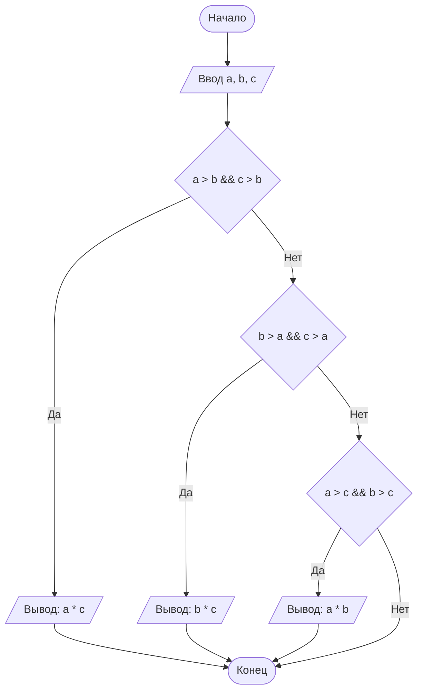

# Домашнее задание к работе 6

## Условие задачи
Написать программу нахождения произведения двух наибольших из трех введенных с клавиатуры чисел.

## Алгоритм и блок-схема

### Алгоритм
1. Начало.
2. Объявить целочисленные переменные `a`, `b`, `c`.
3. Ввести значения трех чисел с клавиатуры: `a`, `b`, `c`.
4. Проверить условие: если `(a > b && c > b)` (число `b` наименьшее), то вычислить и вывести произведение `a * c`.
5. Проверить условие: если `(b > a && c > a)` (число `a` наименьшее), то вычислить и вывести произведение `b * c`.
6. Проверить условие: если `(a > c && b > c)` (число `c` наименьшее), то вычислить и вывести произведение `a * b`.
7. Конец.

## Блок-схема

<!-- Для вставки картинки из draw.io загрузите ее в Issue/Pull Request на GitHub и замените ссылку в src -->




## Реализация программы

```c
#define _CRT_SECURE_NO_WARNINGS
#include <stdio.h>

int homework() {
    puts("HOMEWORK-----------------------------------------------------------");
    int a, b, c;
    puts("Enter 3 numbers:");
    scanf_s("%d %d %d", &a, &b, &c);

    if (a > b && c > b)
        printf("The product of the two largest numbers: %d\n", a * c);
    if (b > a && c > a)
        printf("The product of the two largest numbers: %d\n", b * c);
    if (a > c && b > c)
        printf("The product of the two largest numbers: %d\n", a * b);

    return 0;
}
```

## Результаты работы программы

```text
HOMEWORK-----------------------------------------------------------
Enter 3 numbers:
4 9 7
The product of the two largest numbers: 63
```

## Информация о разработчике
Панарин Егор БИД-261